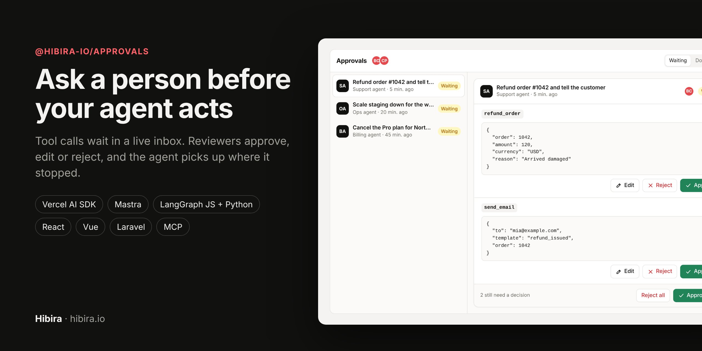
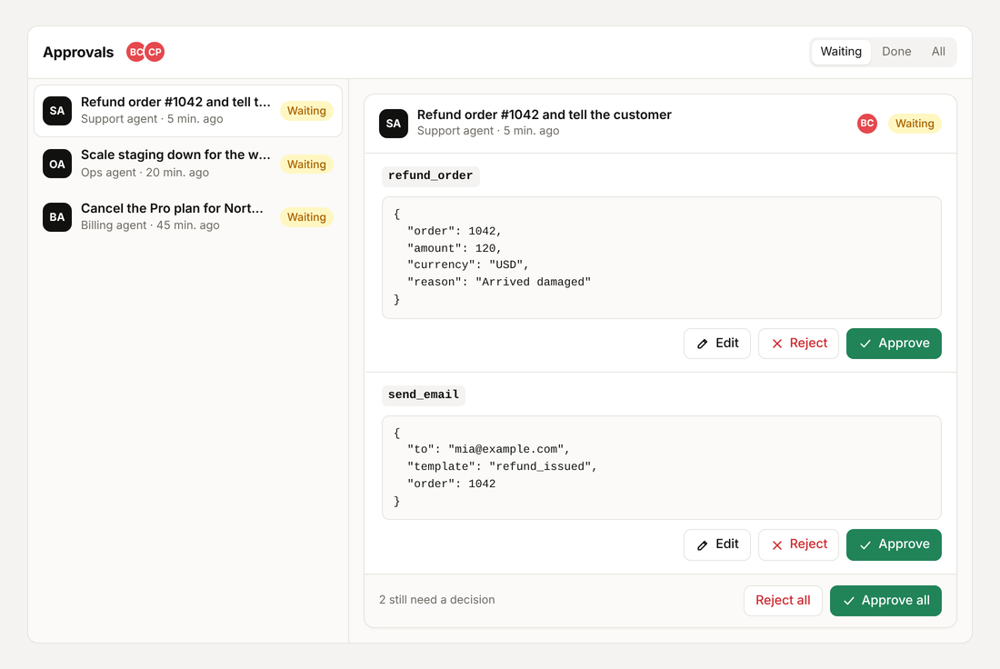
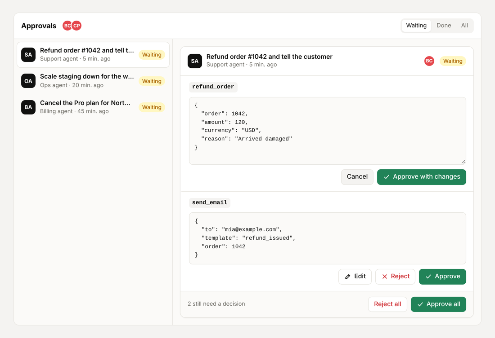
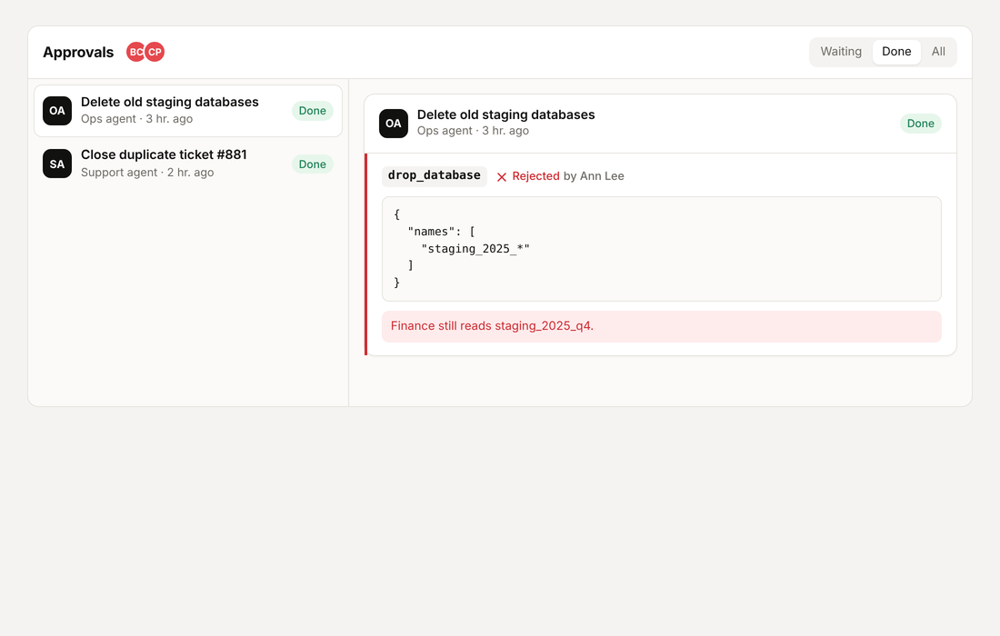
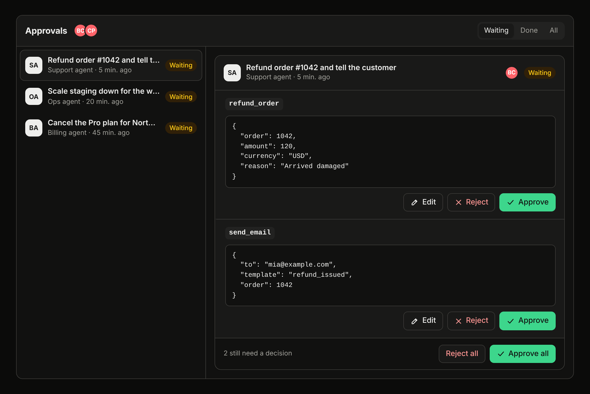
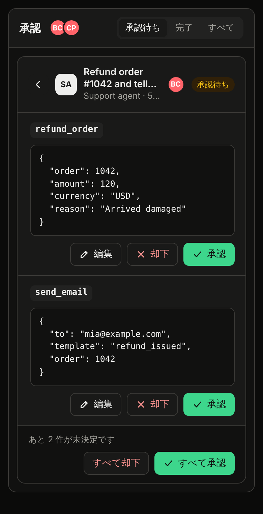
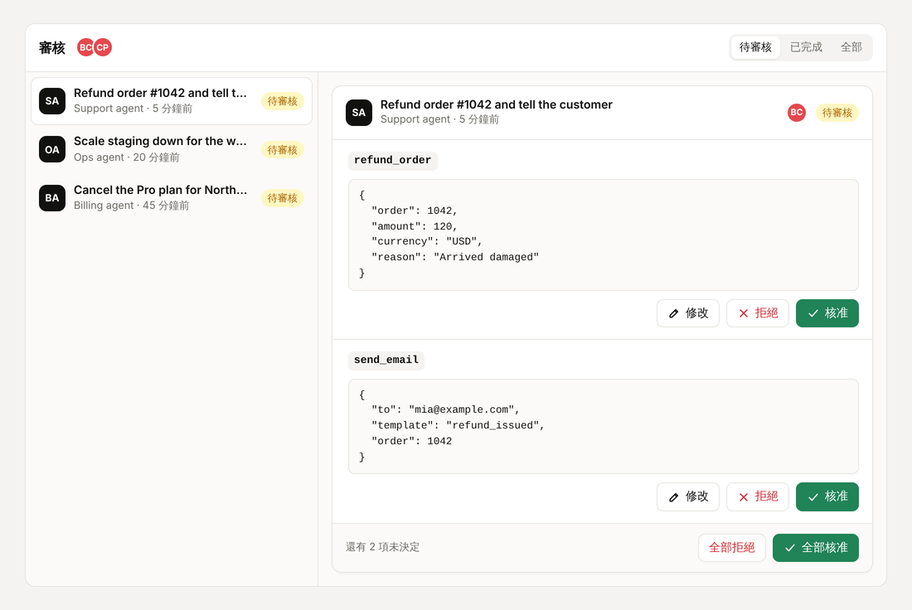

<p align="center"></p>

# @hibira-io/approvals

Human approvals for AI agents, over [Hibira](https://hibira.io) realtime
channels. When an agent wants to run a tool that needs a person's OK, the
call waits in a live inbox. Reviewers approve, edit or reject it, see who
else is looking, and the agent carries on where it stopped.

- **Server helpers** for the [Vercel AI SDK](https://ai-sdk.dev)
  (`needsApproval`), [Mastra](https://mastra.ai) (`requireApproval`,
  `suspend()`) and [LangGraph](https://langchain-ai.github.io/langgraphjs/)
  (`interrupt()`), plus a framework-free core for anything else.
- **React and Vue components**: an inbox and a single-request card, in seven
  languages, light and dark.
- **Database write gates** (`@hibira-io/approvals/sql`): reads run, writes
  wait for a reviewer with the exact statement, estimated rows and a
  fingerprint, so approving one statement never runs another.
- **One protocol** ([PROTOCOL.md](PROTOCOL.md)) shared with the
  [Python package](python/) (LangGraph Python + FastAPI),
  [filament-approvals](https://github.com/hibira-io/filament-approvals)
  (Laravel AI SDK) and the Hibira MCP server's `request_approval` tool. A
  React inbox can show requests from any of them.



| Edit the input before approving | Rejected, with the reason the agent saw |
| --- | --- |
|  |  |

| Dark mode | Phones (Japanese) | Vue (Traditional Chinese) |
| --- | --- | --- |
|  |  |  |

## Install

```sh
npm install @hibira-io/approvals pusher pusher-js
```

`pusher` (server) and `pusher-js` (browser) are the standard Pusher
libraries; point them at your Hibira app. React 17+ or Vue 3.3+ for the
components. Node 20+ on the server.

## How it works

1. Your agent run stops on a tool call that needs approval.
2. You turn the stopped run into calls and open a request:
   `approvals.request({ calls })`. Reviewers get an `approval` event on
   `private-hibira-approvals.{scope}.inbox`; the event carries no tool input,
   so it stays tiny and nothing sensitive crosses the socket.
3. Reviewers decide in the inbox. The components call your backend (the
   routes in [PROTOCOL.md](PROTOCOL.md)), never client events.
4. Once every call is decided, your `resume(request)` gives the agent its
   answers. It runs once, even if two reviewers press Send together. If it
   throws, the request shows as failed with a Retry button.

## Server

```js
import Pusher from 'pusher';
import { createApprovals } from '@hibira-io/approvals';

const pusher = new Pusher({
  appId: process.env.HIBIRA_APP_ID,
  key: process.env.HIBIRA_KEY,
  secret: process.env.HIBIRA_SECRET,
  host: 'ws.hibira.io', // the host shown on your app page
  useTLS: true,
});

export const approvals = createApprovals({
  pusher,
  scope: 'support', // groups requests and reviewers
  resume: async (request) => {
    /* give the agent its answers: see the framework sections below */
  },
  notify: async (request) => {
    /* optional: push, email or Slack the reviewers */
  },
});
```

Requests live in memory by default. In production pass `store`: an object
with `create`, `get`, `list` and an atomic `update(id, fn)` over your
database (see `ApprovalStore` in `index.d.ts`).

### Routes

`approvals.handler()` returns a web-standard `(Request) => Response` that
serves the inbox's routes and the channel authorization:

```js
// app/api/approvals/[[...path]]/route.js (Next.js)
import { approvals } from '@/lib/approvals';
import { auth } from '@/auth';

const handle = approvals.handler({
  basePath: '/api/approvals',
  getUser: async () => {
    const session = await auth();
    return session?.user ? { id: session.user.id, name: session.user.name, avatar: session.user.image } : null;
  },
  canReview: (user, request) => user.role === 'admin', // request is null for the inbox as a whole
});

export { handle as GET, handle as POST, handle as DELETE };
```

For Express or `node:http`, wrap it with `nodeHandler(handle)` and mount it
before any body parser. `getUser` then gets `request.raw`, the original
`req`.

## Vercel AI SDK

Mark the tool with `needsApproval`, then open a request when the result
contains approval requests:

```js
import { generateText, tool } from 'ai';
import { approvalCalls, approvalMessage } from '@hibira-io/approvals/ai-sdk';

const tools = {
  refund_order: tool({ inputSchema, needsApproval: true, execute: refund }),
};

const result = await generateText({ model, tools, messages });
await saveMessages(chatId, [...messages, ...result.response.messages]);

const calls = approvalCalls(result);
if (calls.length) {
  await approvals.request({ agent: 'Support agent', title: 'Refund order #1042', calls, metadata: { chatId } });
}

// in createApprovals({ resume }):
async function resume(request) {
  const history = await loadMessages(request.metadata.chatId);
  const next = [...history, approvalMessage(request)];
  const result = await generateText({ model, tools, messages: next });
  await saveMessages(request.metadata.chatId, [...next, ...result.response.messages]);
}
```

With `useChat`, `approvalCalls(uiMessages)` reads the `approval-requested`
parts and `applyToUIMessages(uiMessages, request)` writes the answers back.
The AI SDK's approvals are yes or no, so an **edit** reaches the model as a
rejection whose reason carries the reviewer's input to call again with.

## Mastra

```js
import { approvalCalls, resumeMastra } from '@hibira-io/approvals/mastra';

const output = await agent.generate('Refund order 1042');
if (output.finishReason === 'suspended') {
  const { calls, metadata } = approvalCalls(output); // or a run from agent.listSuspendedRuns()
  await approvals.request({ agent: 'Support agent', calls, metadata });
}

// in createApprovals({ resume }):
const resume = (request) => resumeMastra(agent, request);
```

Tools with `requireApproval: true` are approved or declined (with the
reason). Tools that call `suspend()` resume with
`{ decision, approved, input?, reason? }`, so an edit really changes the
input:

```js
execute: async (input, ctx) => {
  const answer = ctx.agent.resumeData;
  if (!answer) return ctx.agent.suspend({ order: input.order });
  if (!answer.approved) return { skipped: answer.reason };
  return refund(answer.input ?? input);
}
```

## LangGraph (JS)

```js
import { interrupt, Command } from '@langchain/langgraph';
import { approval, approvalCalls, resumeValue } from '@hibira-io/approvals/langgraph';

function refundNode(state) {
  const answer = interrupt(approval({ tool: 'refund_order', input: { order: state.order } }));
  if (!answer.approved) return { log: [`skipped: ${answer.reason}`] };
  return { log: [refund(answer.input)] }; // the edited input when the reviewer changed it
}

const paused = await graph.invoke({ order: 1042 }, config);
const { calls, title } = approvalCalls(paused); // parallel interrupts become one request
if (calls.length) await approvals.request({ title, calls, metadata: { threadId: config.configurable.thread_id } });

// in createApprovals({ resume }):
const resume = (request) =>
  graph.invoke(new Command({ resume: resumeValue(request) }), { configurable: { thread_id: request.metadata.threadId } });
```

For LangGraph in Python, see [`python/`](python/).

## Gate database writes

Let an agent query your database freely but stop before it changes
anything. `@hibira-io/approvals/sql` sorts each statement into a read or a
write; reads run at once, writes wait for a reviewer, who sees the exact
statement and a preview of what it will touch:

- `classifySql(sql)` returns `'read'` or `'write'`. Several statements,
  data-modifying CTEs, `EXPLAIN ANALYZE`, `SELECT ... INTO`, `FOR UPDATE` and
  anything it cannot parse for sure count as writes. It is a convenience,
  not a security boundary: run reads on a read-only connection or in a
  `READ ONLY` transaction, so a statement it misjudges fails instead of
  writing.
- `sqlFingerprint(sql)` is the SHA-256 of the exact text, and
  `assertApprovedSql(sql, fingerprint)` throws unless the statement about to
  run is that one. Store the fingerprint with the request and check it right
  before running, so approving A can never run B.
- `sqlPreview({ sql, rows, plan, fingerprint })` is the text reviewers see.
  Pass it as a call's `preview`: the inbox shows it under the input.

Your database credentials and data stay on your server: only the request
(statement and preview) goes to the reviewers, and the realtime event that
tells them about it carries neither.

Estimate the rows on your side. With PostgreSQL and `pg`, `EXPLAIN` does not
run the statement; a dry run in a rolled-back transaction gives the exact
count but does run it (locks, triggers), so give it a timeout:

```js
import pg from 'pg';

const pool = new pg.Pool({ connectionString: process.env.DATABASE_URL });

export async function readOnly(sql) {
  const db = await pool.connect();
  try {
    await db.query('BEGIN READ ONLY');
    const { rows } = await db.query(sql);
    await db.query('COMMIT');
    return rows.slice(0, 200);
  } catch (err) {
    await db.query('ROLLBACK');
    throw err;
  } finally {
    db.release();
  }
}

export async function estimateRows(sql) {
  const db = await pool.connect();
  try {
    await db.query('BEGIN');
    await db.query("SET LOCAL statement_timeout = '5s'");
    return (await db.query(sql)).rowCount; // or: EXPLAIN (FORMAT JSON) and read "Plan Rows"
  } finally {
    await db.query('ROLLBACK');
    db.release();
  }
}

// fingerprint: what the reviewer approved, when the statement reaches you
// separately from the approval (hosted page, queue, another service).
export async function runWrite(sql, fingerprint) {
  if (fingerprint) await assertApprovedSql(sql, fingerprint);
  return (await pool.query(sql)).rowCount;
}
```

### Vercel AI SDK

`needsApproval` takes a function, so only writes stop the run:

```js
import { tool } from 'ai';
import { z } from 'zod';
import { approvalCalls } from '@hibira-io/approvals/ai-sdk';
import { classifySql, sqlFingerprint, sqlPreview } from '@hibira-io/approvals/sql';

const tools = {
  run_sql: tool({
    description: 'Run one SQL statement on the shop database.',
    inputSchema: z.object({ sql: z.string() }),
    needsApproval: ({ sql }) => classifySql(sql) === 'write',
    execute: async ({ sql }) => (classifySql(sql) === 'read' ? readOnly(sql) : runWrite(sql)),
  }),
};

const result = await generateText({ model, tools, messages });
const calls = await Promise.all(
  approvalCalls(result).map(async (c) => {
    const fingerprint = await sqlFingerprint(c.input.sql);
    const rows = await estimateRows(c.input.sql);
    return { ...c, preview: sqlPreview({ sql: c.input.sql, rows, fingerprint }) };
  }),
);
if (calls.length) {
  await approvals.request({ agent: 'Data assistant', title: 'Database change', calls, metadata: { chatId } });
}
```

The AI SDK runs exactly the tool call the reviewer approved, matched by its
id, so here the fingerprint is for the reviewer and your audit log. An
**edit** reaches the model as a rejection with the reviewer's SQL,
so the model calls `run_sql` again and the new statement gets its own
preview and approval.

### Mastra

`requireApproval` takes a function too:

```js
const runSql = createTool({
  id: 'run_sql',
  inputSchema: z.object({ sql: z.string() }),
  requireApproval: ({ sql }) => classifySql(sql) === 'write',
  execute: async ({ sql }) => (classifySql(sql) === 'read' ? readOnly(sql) : runWrite(sql)),
});

const output = await agent.generate('Close the carts nobody touched in 30 days');
if (output.finishReason === 'suspended') {
  const { calls, metadata } = approvalCalls(output);
  const withPreview = await Promise.all(
    calls.map(async (c) => ({ ...c, preview: sqlPreview({ sql: c.input.sql, rows: await estimateRows(c.input.sql) }) })),
  );
  await approvals.request({ agent: 'Data assistant', title: 'Database change', calls: withPreview, metadata });
}
```

### LangGraph (JS)

Ask inside the node, and ask again when a reviewer edits the statement, so
whatever runs was previewed and approved as it is:

```js
async function sqlNode(state) {
  let sql = state.sql;
  if (classifySql(sql) === 'read') return { result: await readOnly(sql) };
  for (;;) {
    const fingerprint = await sqlFingerprint(sql);
    const preview = sqlPreview({ sql, rows: await estimateRows(sql), fingerprint });
    const answer = interrupt(approval({ tool: 'run_sql', input: { sql }, preview, title: 'Database change' }));
    if (!answer.approved) return { result: `not run: ${answer.reason ?? 'rejected'}` };
    if (answer.input?.sql && answer.input.sql !== sql) {
      sql = answer.input.sql; // edited: preview and ask again
      continue;
    }
    return { result: await runWrite(sql, fingerprint) };
  }
}
```

LangGraph replays the node from the top on resume, so keep `estimateRows`
free of side effects (EXPLAIN, or the rolled-back dry run). For Python, see
[`python/`](python/README.md#gate-database-writes).

### Without an inbox in your app

Hibira can host the approval page instead: `POST /apps/APP_ID/approvals`
(the [approvals HTTP API](https://hibira.io/use-cases/database-write-approvals))
or the MCP tool `request_approval`, with the statement and preview as
`details` and a private `channel`. The supervisor answers on a link or push
notification, your server gets an `approval` event on that channel when
they decide (no polling), reads the answer once to confirm it, checks the
fingerprint and runs the statement.

## React

```jsx
import Pusher from 'pusher-js';
import { ApprovalInbox, ApprovalCard, createApprovalsClient } from '@hibira-io/approvals/react';
import '@hibira-io/approvals/styles.css';

const pusher = new Pusher(HIBIRA_KEY, {
  wsHost: 'ws.hibira.io',
  forceTLS: true,
  cluster: 'hibira', // pusher-js insists on one; Hibira ignores it
  channelAuthorization: { endpoint: '/api/approvals/auth', transport: 'ajax' },
});
const client = createApprovalsClient({ endpoint: '/api/approvals', pusher, scope: 'support' });

export function ApprovalsPage({ me }) {
  return <ApprovalInbox client={client} me={me.id} locale="en" />;
}

// One request inline, e.g. under the agent's message in your chat:
<ApprovalCard client={client} id={requestId} />;
```

`useApprovalInbox(client, { id })` gives you the same state and actions
(`decide`, `send`, `undo`...) to build your own UI.

## Vue

```vue
<script setup>
import { ApprovalInbox, createApprovalsClient } from '@hibira-io/approvals/vue';
import '@hibira-io/approvals/styles.css';

const client = createApprovalsClient({ endpoint: '/api/approvals', pusher, scope: 'support' });
</script>

<template>
  <ApprovalInbox :client="client" :me="user.id" locale="zh-TW" />
</template>
```

## Look and languages

`styles.css` defines every color as a `--hb-ap-*` variable on `.hb-ap` and
`.hb-ap-card`, so restyling is a few overrides. Dark mode follows the
system, or set `data-theme="dark"` / `"light"` on any ancestor. Labels ship
in English, Traditional and Simplified Chinese, Japanese, Korean, Thai and
Vietnamese (`locale`); override single strings with `labels`.

## Other APIs

- `approvals.wait(id)` polls until a request is decided, for long-running
  workers that keep the agent waiting in place instead of resuming later.
- `approvals.resolve(id)` marks a request answered somewhere else, such as
  the app's own chat. `approvals.expire()` expires overdue requests
  (`expiresIn` on `request()`); run it from a cron.
- `approvals.authorize(socketId, channel, user)` if you serve channel
  authorization yourself.

## License

MIT
