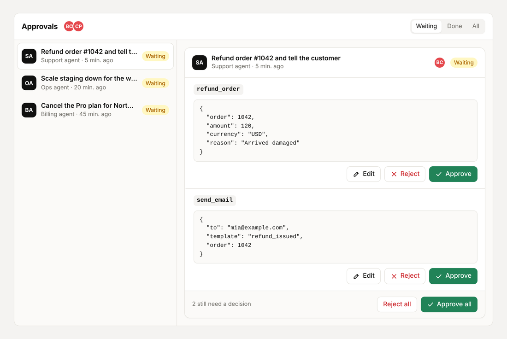

# hibira-approvals

Human approvals for AI agents over [Hibira](https://hibira.io) realtime
channels, for Python. When a LangGraph node needs a person's OK, the call
waits in a live inbox; reviewers approve, edit or reject it, and the graph
resumes with their answer.

It speaks the same protocol as the npm package
[`@hibira-io/approvals`](https://github.com/hibira-io/approvals), so its
React and Vue inbox components work against a Python backend unchanged.



## Install

```sh
pip install "hibira-approvals[pusher,fastapi]"
```

## Use with LangGraph

```python
import pusher
from langgraph.types import Command, interrupt

from hibira_approvals import Approvals
from hibira_approvals.langgraph import approval, approval_calls, resume_value

client = pusher.Pusher(app_id=..., key=..., secret=..., host="ws.hibira.io", ssl=True)


def refund_node(state):
    answer = interrupt(approval("refund_order", {"order": state["order"]}))
    if not answer["approved"]:
        return {"log": [f"skipped: {answer['reason']}"]}
    return {"log": [refund(answer["input"])]}  # the edited input when the reviewer changed it


async def resume(request):
    config = {"configurable": {"thread_id": request["metadata"]["thread_id"]}}
    await graph.ainvoke(Command(resume=resume_value(request)), config)


approvals = Approvals(client, scope="support", resume=resume)

paused = await graph.ainvoke({"order": 1042}, config)
calls, title = approval_calls(paused)  # parallel interrupts become one request
if calls:
    await approvals.request(calls, agent="Support agent", title=title, metadata={"thread_id": "t1"})
```

`approvals.wait(id)` polls until a request is decided, for workers that keep
the graph waiting in place.

## Gate database writes

`hibira_approvals.sql` matches `@hibira-io/approvals/sql`: reads run at
once, writes wait for a reviewer who sees the exact statement, the
estimated rows and its SHA-256. `classify_sql` treats several statements,
data-modifying CTEs, `EXPLAIN ANALYZE` and anything unclear as writes; run
reads on a read-only connection anyway, so a misjudged statement fails
instead of writing. With psycopg 3 and PostgreSQL:

```python
import psycopg
from langgraph.types import interrupt

from hibira_approvals.langgraph import approval
from hibira_approvals.sql import assert_approved_sql, classify_sql, sql_fingerprint, sql_preview

DSN = "postgresql://..."


def read_only(sql: str) -> list:
    with psycopg.connect(DSN) as db:
        db.read_only = True
        return db.execute(sql).fetchmany(200)


def estimate_rows(sql: str) -> int:
    # A dry run: runs the statement and rolls it back. EXPLAIN avoids running it.
    with psycopg.connect(DSN) as db:
        with db.transaction(force_rollback=True):
            db.execute("SET LOCAL statement_timeout = '5s'")
            return db.execute(sql).rowcount


def sql_node(state):
    sql = state["sql"]
    if classify_sql(sql) == "read":
        return {"result": read_only(sql)}
    while True:
        fingerprint = sql_fingerprint(sql)
        preview = sql_preview(sql, rows=estimate_rows(sql), fingerprint=fingerprint)
        answer = interrupt(approval("run_sql", {"sql": sql}, title="Database change", preview=preview))
        if not answer["approved"]:
            return {"result": f"not run: {answer['reason'] or 'rejected'}"}
        edited = (answer["input"] or {}).get("sql")
        if edited and edited != sql:
            sql = edited  # preview and ask again
            continue
        assert_approved_sql(sql, fingerprint)
        with psycopg.connect(DSN) as db:
            return {"result": db.execute(sql).rowcount}
```

`approval_calls()` carries each call's `preview` into the request, and the
React and Vue inbox show it under the statement. LangGraph replays the node
on resume, so `estimate_rows` must not change anything (the dry run rolls
back; EXPLAIN never runs the statement).

## Routes for the inbox components

```python
from fastapi import FastAPI
from hibira_approvals.fastapi import approvals_router

app = FastAPI()
app.include_router(
    approvals_router(approvals, get_user=current_user, can_review=lambda user, request: user["role"] == "admin"),
    prefix="/api/approvals",
)
```

`get_user(request)` returns `{"id", "name", "avatar"}` or `None`. The router
also serves `POST /auth` for the Pusher channel authorization.

Requests live in memory by default; pass `store=` with async `create`,
`get`, `list` and an atomic `update(id, fn)` over your database.

## License

MIT
